<div align="center">



<br />

<a href="https://davidzabalaasir-create.github.io/portfolio/"></a>
<a href="https://davidzabalaasir-create.github.io/portfolio/CV_David_Zabala_Maira.pdf"></a>
<a href="https://www.linkedin.com/in/david-zabala-66b655233"></a>
<a href="https://github.com/davidzabalaasir-create/portfolio/actions/workflows/deploy.yml"></a>

</div>

```console
david@asir-lab:~$ whoami
David Zabala · estudiante de ASIR · Bilbao, ES

david@asir-lab:~$ cat ~/.motd
Construyo infraestructuras claras, seguras y fáciles de mantener,
desde la red hasta la automatización.

david@asir-lab:~$ locale --idiomas
español (nativo) · inglés (B1) · euskera (B1)
```

## `01` · `traceroute ~/formación`



| hop | periodo | ciclo | estado |
| :-: | :-- | :-- | :-- |
| `1` | 2023 — 2025 | **SMR** · Sistemas Microinformáticos y Redes · Mikeldi | ✅ completado |
| `2` | 2025 — hoy | **ASIR** · Administración de Sistemas Informáticos en Red | 🟢 en curso |

<details>
<summary><b>📚 Formación complementaria</b></summary>

<br />

- Hoja de cálculo Excel — 60 h, curso autorizado por Lanbide (2026)
- Informática y ofimática: Windows, Word, Excel, PowerPoint e Internet — Centro de Estudio Inatec

</details>

## `02` · `journalctl --experiencia`

```log
feb 2026 — may 2026  Técnico informático · Worten (Portugal)
  ├─ diagnóstico, reparación y mantenimiento de equipos (hardware y software)
  ├─ instalación y configuración de Windows 10/11 · restauraciones de fábrica
  ├─ BIOS/UEFI · sustitución de RAM, HDD/SSD y fuentes de alimentación
  └─ incidencias: virus, controladores, actualizaciones y recuperación de datos

mar 2022 — may 2022  Técnico de redes de datos (FCT) · Colegio Gaztelueta
  ├─ configuración y mantenimiento de la red LAN del centro
  ├─ switches, puntos de acceso WiFi y cableado estructurado Cat5e/Cat6
  ├─ incidencias de conectividad TCP/IP, direccionamiento IP y DNS
  └─ soporte técnico a usuarios y configuración de equipos
```

## `03` · `ls -la ~/proyectos`



<details>
<summary><b>📂 Ver detalles de cada laboratorio</b></summary>

<br />

| proyecto | área | qué resuelve | estado |
| :-- | :-- | :-- | :-- |
| **NEXUS MONITOR** | sistemas | Vigilar servicios, latencias y capacidad en una red híbrida con dashboards. | 🟢 operativo |
| **LABORATORIO LAN** | redes | Segmentar la red con VLAN, firewall perimetral y servicios aislados por rol. | 🟢 operativo |
| **BACKUP ZERO** | sistemas | Copias 3-2-1 automatizadas con snapshots, cifrado y restauraciones verificadas. | 🟠 en evolución |
| **SURICATA SHIELD** | seguridad | Detectar intrusiones analizando el tráfico y responder ante amenazas. | 🟠 en evolución |
| **[EJPTV2 CHEATSHEET](https://ejptv2-pentest-cheatsheet.vercel.app)** | seguridad | Web de estudio para la eJPTv2: comandos de pentesting por fases, buscador, filtros y checklist. | 🟢 operativo |
| **[SYSADMIN CHEATSHEET](https://davidzabalaasir-create.github.io/sysadmin-cheatsheet/)** | sistemas | Biblioteca bilingüe de 256 comandos (Linux, Windows, AD, redes, contenedores) con modo práctica y PWA. [Código](https://github.com/davidzabalaasir-create/sysadmin-cheatsheet) | 🟢 operativo |

</details>

🛡️ **aiSOC** — demo interactiva en la web: una consola SOC simulada sobre la red de los laboratorios, con alertas en directo y un analista IA que las explica, las relaciona con MITRE ATT&CK y ejecuta la respuesta. [Probar la demo →](https://davidzabalaasir-create.github.io/portfolio/#aisoc)

📘 **[Manual de laboratorios](docs/laboratorios/README.md)** — configuración paso a paso de cada proyecto y las capturas que documentan el resultado.

## `04` · `nmap --topology ~/laboratorio-lan`



<sub>Esquema del laboratorio de red: el tráfico entra por pfSense, Suricata lo inspecciona y cada VLAN queda aislada según su rol.</sub>

## `05` · `apt list --installed`

<table>
  <tr>
    <td valign="top" width="20%">

**`~/sistemas`**


</td>
    <td valign="top" width="20%">

**`~/soporte & hardware`**


</td>
    <td valign="top" width="20%">

**`~/redes & seguridad`**


</td>
    <td valign="top" width="20%">

**`~/automatización`**


</td>
    <td valign="top" width="20%">

**`~/desarrollo web`**


</td>
  </tr>
</table>

## `06` · `systemctl status portfolio`

```diff
● portfolio.service - Portfolio personal (React + TypeScript + Vite)
     Loaded: loaded (src/content.ts; enabled) · idiomas: es, en
+    Active: active (running) en GitHub Pages
+    Audit:  Lighthouse — rendimiento 99 · accesibilidad 100 · buenas prácticas 100 · SEO 100
     Docs:   CV y carta de motivación descargables en la sección «documentos»
```

<details>
<summary><b>🛠️ Arrancarlo en local</b></summary>

<br />

```bash
git clone https://github.com/davidzabalaasir-create/portfolio.git
cd portfolio
npm install
npm run dev      # servidor de desarrollo
npm run build    # build de producción en dist/
```

El contenido editable (proyectos, formación, experiencia, stack, contacto) vive en `src/content.ts`, en español e inglés; los estilos en `src/styles.css`. Cada push a `main` se publica automáticamente en GitHub Pages, y Dependabot propone cada semana las actualizaciones de dependencias.

</details>

## `07` · `ssh david@contacto`

<div align="center">

**¿Buscas un técnico? Aquí estoy.** Disponible para prácticas y proyectos.

<a href="mailto:davidzamaira2003@gmail.com"></a>
<a href="https://www.linkedin.com/in/david-zabala-66b655233"></a>
<a href="https://github.com/davidzabalaasir-create"></a>

<sub><code>exit 0</code> · construido con curiosidad + café</sub>

</div>
